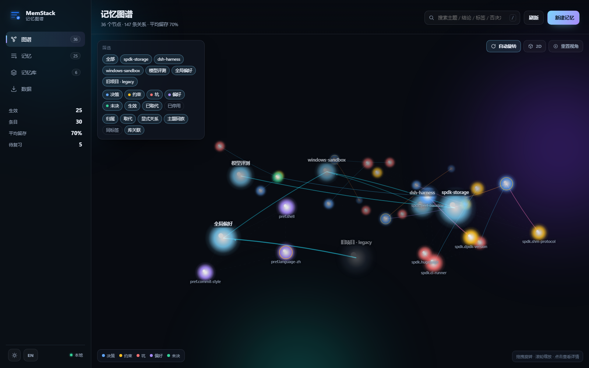
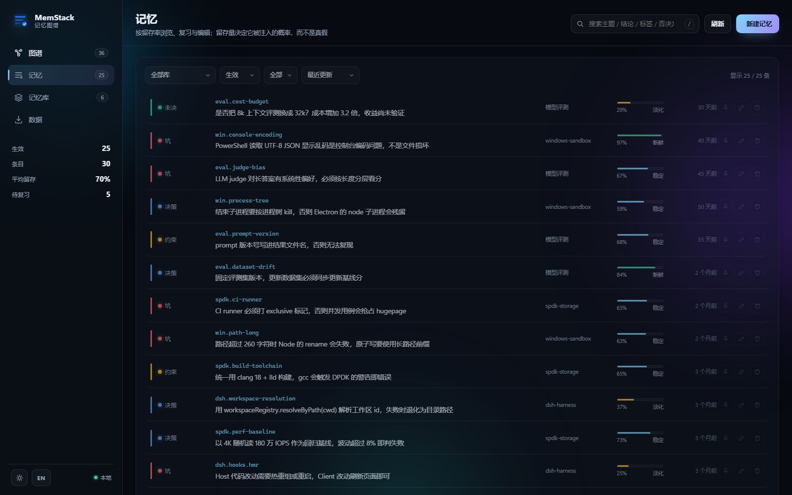
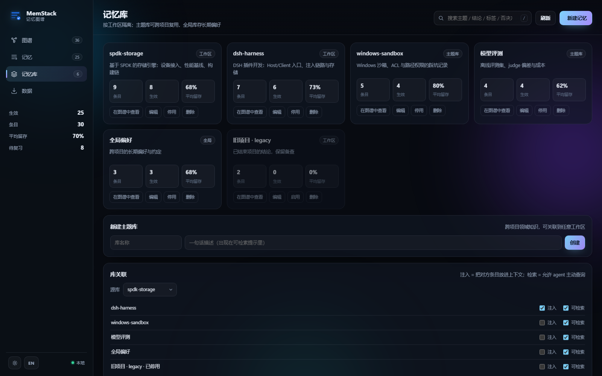
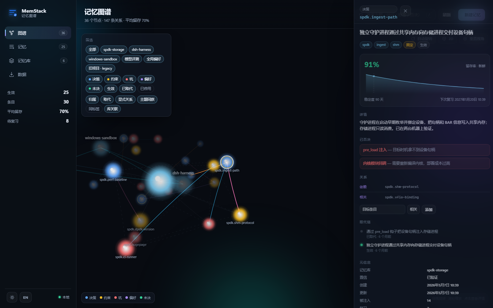
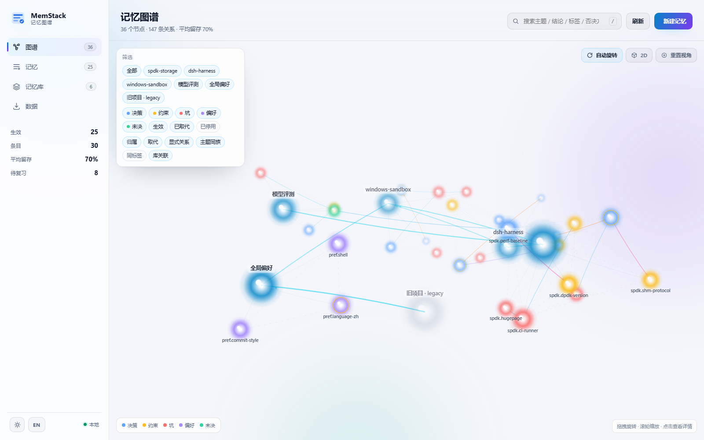

# MemStack

> 给 [DeepSeek Harness](https://github.com/deepseek-ai) 加一层**可治理的项目记忆**：记住的是“现在仍然成立”的判断，不是对话摘要。



模型会忘记上下文，也会记错事。多数“记忆”方案只做了一半——把对话压成摘要存起来——于是你会遇到这个熟悉的过程：试过方案 A 发现不行，改用方案 B，但记忆里 A 还在，之后模型反复建议 A，而你没法定点删掉它。

MemStack 的四条对策：

| 问题 | 做法 |
|---|---|
| 新旧结论并存 | 同一 `topic` 只允许一条生效；写新结论时旧的自动变 `superseded`，历史完整保留 |
| 模型反复推荐旧方案 | 旧条目保留 `rejected[]`（被否决的选项 + 原因），注入时明确标注“已失效，不要再建议” |
| 全局污染 | 记忆按工作区隔离；跨库默认只可检索，不默认注入上下文 |
| 看不见、改不动 | 本地控制台：图谱、列表、库、数据迁移；每条都能编辑、停用、删除 |

v0.3.0 · 零运行时依赖 · 无构建步骤 · MIT

---

## 快速开始

前提：DSH Desktop 已安装，本仓库已在本地（例如 `D:\dsh-memstack`）。

```powershell
# 1. 装进 desktop profile（<DSH> 换成你的 DSH 安装目录）
& '<DSH>\resources\runtime\cli\bin\dsh.cmd' plugin --profile desktop add "link:D:\dsh-memstack"

# 2. 打开本地控制台（插件随 Host 一起拉起，端口 7788）
#    http://127.0.0.1:7788

# 3. 在任意会话里让它记一条
#    「记一下：这个项目用 PowerShell 原生命令，不走 WSL」
```

安装命令会把包写进 profile 的 `dependencies` 与 `dsh.profile.bundles`，随后热重组生效；没生效就重启 DSH。

数据落在 `$DSH_HOME/memstack/memstack.db`（默认 `C:\Users\<你>\.dsh\memstack\memstack.db`），SQLite WAL 模式，由 Node 内置的 `node:sqlite` 驱动，不引入任何 npm 依赖。

卸载：`dsh plugin --profile desktop remove @local/memstack`。**卸载不会删数据**。

---

## 记忆的生命周期

```
写入 ──▶ 注入 ──▶ 取代 ──▶ 遗忘 ──▶ 复习
```

1. **写入**：模型判断出现“决策 / 约束 / 踩坑 / 偏好 / 未决问题”，且信息无法从仓库里直接读出来，调用 `memory_write`。
2. **注入**：会话首次请求注入索引；之后每轮只注入**差异**，以 `<system-reminder>` 形式追加，不重写历史。
3. **取代**：同 `topic` 再写入时，旧条目转 `superseded`，双向链接，`rejected[]` 保留否决理由。
4. **遗忘**：留存率随天数指数衰减，只影响“是否被注入”，**任何阶段都不会自动删除**。
5. **复习**：用户确认“仍然成立”后曲线重置；判断“过时”则停用。

## 核心概念

| 概念 | 说明 |
|---|---|
| **Bank（记忆库）** | 记忆的容器。每个工作区惰性建一个 `workspace` 库（标题取目录名），另有跨项目的 `topic` 库与单例 `global` 库 |
| **Entry（条目）** | 一条判断：`topic` + `claim`（一句话结论）+ `detail` + `rejected[]` + `tags[]` + `relations[]` |
| **Topic（主题键）** | 稳定标识，如 `spdk.ingest-path`。同一 bank + topic 只有一条 `active`，它是“同一件事”的锚点 |
| **状态** | `active` 生效 / `superseded` 已取代 / `archived` 已停用；历史不会被静默丢弃 |
| **关系** | `related` / `refines` / `depends` / `contradicts`，可带备注，图谱与详情里都会显示 |
| **稳定度** | `stabilityDays` 是半衰期：多少天后“还记得”的概率降到 50% |
| **置信度** | `verified` 或 `tentative`；不确定的结论明示出来，衰减更快 |

## 记忆是怎么进来的

**没有自动记忆**，这是有意的设计：自动沉淀分不清“决策”和“过程”，噪音一旦进库就会被反复注入、越写越像真的。写入只有三种来源：

| 来源 | 说明 |
|---|---|
| 模型主动写（默认） | 命中五类事件（决策 / 约束 / 踩坑 / 偏好 / 未决问题）、且仓库里查不到时才写；一次最多 3 条 |
| 用户显式要求 | “记一下……”；模型据此调用 `memory_write` |
| 控制台手动 | 「新建记忆」表单，可指定库、类型、标签、否决方案 |

规则以静态 system prompt 段注入，所以即使某个工作区还没有库，模型也知道该在什么时候写；库在首次写入时惰性创建。

## 遗忘曲线

留存率：

```
R = 0.5 ^ (距上次确认的天数 / stabilityDays)
```

| 阶段 | 阈值 | 含义 |
|---|---|---|
| `fresh` 新鲜 | R ≥ 0.80 | 刚确认过，几乎总在上下文里 |
| `stable` 稳定 | R ≥ 0.50 | 仍然可靠 |
| `fading` 淡化 | R ≥ 0.20 | 需要进行时才会出现 |
| `dormant` 沉寂 | R < 0.20 | 默认不注入，但仍可检索 |

- 初始半衰期按类型给：决策 60 天、约束 / 坑 90 天、偏好 120 天、未决问题 14 天
- 复习（用户确认仍然成立）：半衰期 × 1.8，上限 730 天，并重置衰减时钟
- 被注入（模型看到）：半衰期 × `1 + 0.25 × (1 - R)` —— 越难想起，一次加固越多
- 固定（pin）：半衰期 × 4，排到索引最前，且沉寂后仍会注入（不固定则默认不注入，但仍可检索）
- **只降低注入概率，永不自动删除**；已取代 / 已停用条目的留存率冻结在停用那一刻，避免三年老账把图谱染成一片“已遗忘”

会话里的检索结果会带留存率与阶段，模型被要求：留存率偏低时先向用户确认，确认后才调用 `memory_review`。

## 记忆图谱

节点是库与条目，边有六类：

| 边 | 来源 |
|---|---|
| `contains` | 条目归属库 |
| `supersede` | 取代链，旧 → 新 |
| `relation` | 显式关系，带子类型与备注 |
| `topic` | 同主题族（topic 首段相同），按时间近邻连接 |
| `tag` | 共享标签，每节点最多 3 条，避免连线成毛球 |
| `bank-link` | 库关联（注入 / 可检索） |

派生边是有界启发式：同一标签下按最近更新连成链，而不是两两结成团。渲染是手写 Canvas 2D 的力导向图，没有 three.js、没有 CDN、不需要构建；选中节点会暂停自动旋转并聚焦，抽屉打开时视图中心左移，避免被遮挡。

## 工具

| 工具 | 用途 |
|---|---|
| `memory_write` | 记录决策 / 约束 / 踩坑 / 偏好 / 未决问题；同 topic 自动取代旧结论并返回被取代摘要 |
| `memory_search` | 跨库关键词检索（受库关联的 `query` 权限约束），结果带留存率与阶段 |
| `memory_read` | 读取单条全文、替代链、关系与衰减信息 |
| `memory_forget` | 停用（默认，可恢复）或删除；删除会恢复被它取代的前驱 |
| `memory_review` | 用户确认“仍然成立”后重置曲线；`outdated` 则停用 |
| `memory_relate` | 建立 / 移除两条记忆之间的关系 |
| `memory_inventory` | 按库列出全部条目、状态与留存率 |

写入示例：

```json
{
  "topic": "spdk.ingest-path",
  "kind": "decision",
  "claim": "采用独立守护进程读取设备，放弃 pre_load 注入",
  "detail": "pre_load 在目标时机拿不到设备句柄，实测失败；守护进程经共享内存通信，已验证。",
  "rejected": [{ "option": "pre_load 注入", "reason": "目标时机拿不到设备句柄" }],
  "tags": ["spdk", "ingest"]
}
```

模型在会话里看到的样子：

```
[决策] spdk.ingest-path — 采用独立守护进程读取设备，放弃 pre_load 注入
  ✗ 已否决：pre_load 注入（目标时机拿不到设备句柄）
```

## 本地控制台

默认 **http://127.0.0.1:7788**，随插件启动（先探测端口，已占用则复用）；也可单独起：

```powershell
npm run console
```

| 页面 | 内容 |
|---|---|
| **图谱** | 3D 力导向关系网；按库 / 类型 / 状态 / 边筛选；搜索高亮；点击查看详情 |
| **记忆** | 按留存率浏览；搜索、库 / 状态 / 类型筛选、排序；固定、编辑、删除 |
| **记忆库** | 库卡片（条目 / 生效 / 平均留存）；新建主题库、改名、停用；库关联矩阵 |
| **数据** | 导出 JSON bundle / Markdown；拖拽导入；显示当前库路径；留存与类型分布；待复习队列 |





条目抽屉包含留存曲线、详情、否决理由、关系、替代链、元信息，以及“仍然成立 / 标记过时 / 编辑 / 删除 / 固定”。

页面状态写在地址栏，可刷新还原或直接分享：`#graph`、`#memories`、`#banks`、`#data`，打开条目时为 `#entry=<id>`。支持深 / 浅主题与中英文界面。





### 演示数据

不碰真实库，在隔离的 `.demo/` 目录里播种 30 条记忆：

```powershell
npm run demo
# http://127.0.0.1:7799
```

## 命令行与数据

```powershell
# 导出全部历史（JSON bundle，含已取代条目）
npm run export -- --out memstack.bundle.json

# 只导出某个库
npm run export -- --out spdk.bundle.json --bank spdk-storage

# 导出 Markdown 投影（适合进 git 或直接阅读）
npm run export -- --format markdown -o memory.md

# 导入前先看报告
npm run import -- memstack.bundle.json --dry-run

# 合并（默认，永不静默丢结论）或整库替换
npm run import -- memstack.bundle.json --mode merge
npm run import -- memstack.bundle.json --mode replace
```

合并语义：

- 同 id 且同内容 → 跳过（重复导入幂等）
- 同 id 不同内容 → 分配新 id，关系与取代链一并重映射
- 同库同 topic 已有不同结论 → 导入项存为 `archived`，报告 `topic-taken`，本地结论不被覆盖
- 目标库不存在 → 先按 id、再按 `kind + title` 匹配；匹配不到则新建
- `replace` 会清空本地内容，控制台要求二次确认

备份：导入前用 SQLite 在线备份 API 在同目录写 `memstack.db.<时间戳>.bak`。日常备份推荐导出 bundle；如果直接复制数据库文件，请先退出 Host 与控制台，或连同 `-wal` / `-shm` 一起复制。

旧版 `state.json` 不需要手动转换：升级前先停掉旧版 Host 与控制台（旧进程仍会写 JSON），再启动新版——发现 `state.json` 且库不存在时先完整导入，再把 JSON 改名为 `state.json.migrated-<时间戳>.bak`。迁移失败不会留下空库，原 JSON 保持不动。

## 配置

在 profile 的 `cordis.patch.yml` 里覆盖：

```yaml
- id: memstack
  name: "@local/memstack"
  config:
    injectIndex: true          # 是否注入记忆索引
    indexByteBudget: 4096      # 每轮索引的字节预算
    discoverabilityBudget: 512 # 未注入库的“可检索提示”字节预算
    recallTopK: 40             # 索引最多条目数
    injectGlobalBank: true     # 是否默认注入 global 库
    consoleEnabled: true       # 是否随插件启动控制台
    consolePort: 7788          # 控制台端口（1024–65535）
```

## 工作原理

1. `agent/pre-step` 里组装一条 sourced 用户消息（`<system-reminder>` 包裹），`toSpliced` 进本轮请求的最后一条用户消息之后；
2. 消息来源携带条目快照，下一轮按 `(bank, topic)` 比对，只注入差异；
3. 取代写作渲染成“更新 + 已失效”，而不是“新增 + 删除”；
4. 注入只追加、不重写历史，对 KV cache 友好；
5. 真源是 SQLite：插件与控制台通过 `revision` 感知外部提交，写入走 `BEGIN IMMEDIATE`，冲突时抛 `state-conflict:` 并重载，不用静默覆盖糊弄过去。

目录：

```
index.js            Host 插件入口 apply(ctx, config)
lib/                纯核心：store / database / decay / render / graph / portable / query / tools / inject / console
console/            本地控制台：server.mjs + app.js + graph3d.js + styles.css
locale/             zh.json / en.json
scripts/            受保护的临时 home 工具等
test/               单元与集成测试（真实 HTTP 控制台、SQLite 迁移与并发）
docs/               设计、开发记录、v2 路线与截图
cordis.patch.yml    bundle 插入行
```

## 开发

零运行时依赖、无构建步骤、离线可跑；纯核心（store / decay / graph / render）不 import `@deepseek-ai/*`，时间与 id 都由参数注入。

```powershell
npm test          # node --test，111 项
npm run console   # 只起控制台
npm run demo      # 隔离演示数据（重新播种 SQLite）
```

- 改 Host 代码：重启 Host，或改一行 profile 的 `cordis.patch.yml` 触发重组
- 改控制台：刷新页面即可（静态文件每次请求现读盘）
- 测试固定时钟与临时目录，不联网、不读写真实的 `~/.dsh`

## 有意不做

embedding 语义检索、多人协同、DSH 设置页内的原生页面、自动整理器（合并近似条目 / TTL）、FTS5 中文分词、后台自动沉淀与自动摘要。前几项等到真正需要再补；最后一项是设计上的取舍——自动摘要分不清“决策”和“过程”，会把噪音固化成事实。

## 文档

- [docs/design.md](docs/design.md) — 契约、不变量、数据模型与取舍
- [docs/development.md](docs/development.md) — 分片实施记录与踩坑
- [docs/roadmap-v2.md](docs/roadmap-v2.md) — v2 路线与备选方案

## License

[MIT](LICENSE)
